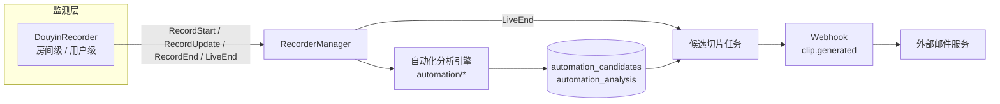
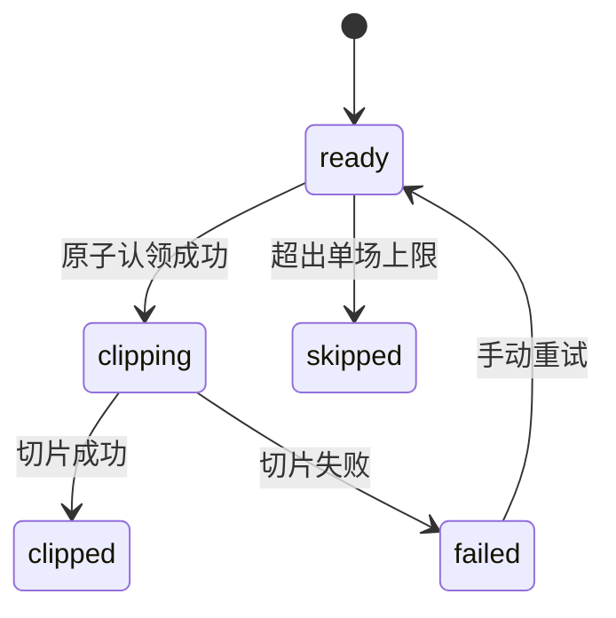
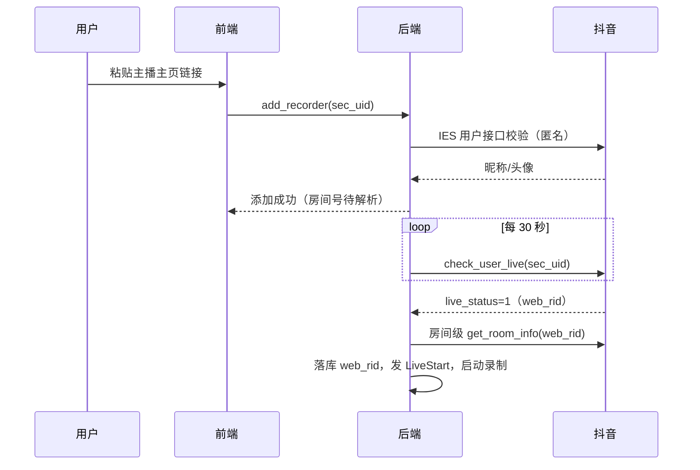

# 抖音自动化开发详设

| 项目 | 值 |
| --- | --- |
| 文档编号 | `DDES-001` |
| 编制日期 | `2026-10-15` |
| 版本 | `0.7` |
| 状态 | 开发中 |
| 依据方案 | `DY-AUTO-001` v0.9、`FDES-001` v0.5 |
| 实现范围 | 后台（Rust）、桌面端（Tauri + Svelte）、Web 端（headless + 同构 Svelte） |

## 1. 文档说明与范围

本文是 `DY-AUTO-001` 的开发详设，覆盖三端实现：

- **后台（Rust）**：监测层（`src-tauri/crates/recorder`）、录制管理器（`src-tauri/src/recorder_manager.rs`）、自动化模块（新增 `src-tauri/src/automation/`）、数据库、Webhook。
- **桌面端（Tauri + Svelte）**：Room / Setting / Task 页面改动，走 Tauri command 与 Tauri event。
- **Web 端（headless + 同构 Svelte）**：HTTP API（`src-tauri/src/http_server/api_server.rs`）与 Socket.IO 事件；UI 复用同一套 Svelte 组件，无独立前端工程。

实现约定：

- 所有后台代码必须同时通过 `gui` 与 `headless` 两个 feature 的编译与 clippy（仓库 pre-commit 检查）。
- 新 handler 一律通过 `state_type!()` 宏适配双形态（gui 为 `TauriState<'_, State>`，headless 为 `State`）。
- 需求回链：各节标注覆盖的 `REQ-*` / `AC-*`；不确定的接口字段标注"实现时复测"（`RISK-008`）。

## 2. 总体架构与模块划分



新增与改动文件清单：

| 区域 | 文件 | 类型 |
| --- | --- | --- |
| 监测 | `crates/recorder/src/lib.rs` | 改：`Recorder` 检测状态字段、`RecorderInfo` 扩展 |
| 监测 | `crates/recorder/src/platforms/common.rs` | 改：`check_live` 错误分类、退避延迟接入 |
| 监测 | `crates/recorder/src/platforms/douyin.rs` | 改：sec_uid 模式、`is_throttled` |
| 监测 | `crates/recorder/src/platforms/douyin/api.rs` | 改：`check_user_live`、ttwid 会话 |
| 监测 | `crates/recorder/src/errors.rs` | 改：错误分类变体 |
| 添加 | `src-tauri/src/handlers/recorder.rs` | 改：主页链接/短链/sec_uid 归一分支 |
| 添加 | `src-tauri/src/database/recorder.rs` | 改：`web_rid` 列读写、`detection_states` 持久化 |
| 分析 | `src-tauri/src/automation/`（mod、scheduler、window、signals、scoring、store） | 新增 |
| 分析 | `src-tauri/src/database/automation.rs` | 新增：两张表 CRUD |
| 分析 | `src-tauri/src/handlers/automation.rs` | 新增：候选查询/重试/配置命令 |
| 分析 | `src-tauri/src/ffmpeg/audio.rs` | 改：范围音频提取 |
| 分析 | `src-tauri/src/ffmpeg/subtitle.rs` | 改：接受外部生成器实例 |
| 分析 | `src-tauri/src/handlers/video_editing.rs` | 改：密度分析抽公共函数 |
| 切片 | `src-tauri/src/recorder_manager.rs` | 改：`handle_live_end` 入队候选切片、`clip_range` 复用 |
| 通知 | `src-tauri/src/webhook/events.rs` | 改：`ClipPayload`（显式判别字段） |
| 配置 | `src-tauri/src/config.rs`、`handlers/config.rs` | 改：两个配置段与更新命令 |
| 启动 | `src-tauri/src/main.rs` | 改：迁移 18/19、恢复调用、命令注册 |
| Web | `src-tauri/src/http_server/api_server.rs` | 改：新路由 |
| 事件 | `src-tauri/src/events/model.rs` | 改：`DataChange::Candidates` |
| 前端 | `src/page/Room.svelte`、`Setting.svelte`、`Task.svelte`、`src/lib/interface.ts`、`src/lib/events.ts` | 改 |
| 前端 | `src/lib/components/CandidatePanel.svelte` | 新增 |

## 3. 数据库设计

### 3.1 新增迁移（`main.rs` `get_migrations()`）

版本 18：自动化与检测状态三张表。

```sql
CREATE TABLE automation_analysis (
    platform TEXT NOT NULL,
    room_id TEXT NOT NULL,
    live_id TEXT NOT NULL,
    parent_id TEXT NOT NULL,
    status TEXT NOT NULL,              -- running / success / failed / interrupted
    stage TEXT NOT NULL,               -- windows / subtitle / scoring
    processed_until_ms INTEGER NOT NULL DEFAULT 0,
    window_seconds INTEGER NOT NULL,
    subtitle_json TEXT,                -- 累积窗口字幕（JSON）
    task_id TEXT,
    error_message TEXT,
    created_at TEXT NOT NULL,
    updated_at TEXT NOT NULL,
    PRIMARY KEY (platform, room_id, live_id)
);
CREATE TABLE automation_candidates (
    id TEXT PRIMARY KEY,               -- uuid，用于通知去重
    platform TEXT NOT NULL,
    room_id TEXT NOT NULL,
    parent_id TEXT NOT NULL,
    live_id TEXT NOT NULL,
    start_ms INTEGER NOT NULL,
    end_ms INTEGER NOT NULL,
    score REAL NOT NULL,
    signals_json TEXT NOT NULL,
    reason TEXT NOT NULL,
    status TEXT NOT NULL,              -- ready / clipping / clipped / failed / skipped
    clip_task_id TEXT,
    video_id INTEGER,
    notify_status TEXT NOT NULL DEFAULT 'pending',  -- pending / accepted / failed
    error_message TEXT,
    created_at TEXT NOT NULL,
    updated_at TEXT NOT NULL,
    UNIQUE (platform, room_id, parent_id, start_ms, end_ms)
);
CREATE INDEX idx_candidates_parent ON automation_candidates (room_id, parent_id);
CREATE TABLE detection_states (
    platform TEXT NOT NULL,
    room_id TEXT NOT NULL,
    confirmed INTEGER,                 -- NULL=未确认 / 0=未开播 / 1=开播中
    last_checked_at INTEGER NOT NULL DEFAULT 0,
    last_success_at INTEGER NOT NULL DEFAULT 0,
    error_kind TEXT NOT NULL DEFAULT '',
    consecutive_unknown INTEGER NOT NULL DEFAULT 0,
    next_retry_at INTEGER NOT NULL DEFAULT 0,
    updated_at TEXT NOT NULL,
    PRIMARY KEY (platform, room_id)
);
```

版本 19：录制器表扩展。

```sql
ALTER TABLE recorders ADD COLUMN web_rid TEXT;
```

`web_rid` 语义：主页模式首次开播解析后写入；房间号模式为 NULL（房间号即 `room_id`）。

版本 20：标识类型和通知任务。

```sql
ALTER TABLE recorders ADD COLUMN identifier_type TEXT NOT NULL DEFAULT 'room';
CREATE TABLE automation_notifications (
    id TEXT PRIMARY KEY,
    candidate_id TEXT NOT NULL UNIQUE,
    event_json TEXT NOT NULL,
    status TEXT NOT NULL DEFAULT 'pending', -- pending / sending / accepted / failed
    attempts INTEGER NOT NULL DEFAULT 0,
    next_retry_at INTEGER NOT NULL DEFAULT 0,
    last_error TEXT,
    created_at TEXT NOT NULL,
    updated_at TEXT NOT NULL
);
CREATE INDEX idx_automation_notifications_retry
    ON automation_notifications (status, next_retry_at);
```

`identifier_type` 只允许 `profile` 和 `room`。房间号模式以 `room_id` 作为有效 `web_rid`，`web_rid` 列保持空；主页模式以 `room_id` 保存 `sec_uid`，首次开播解析后写入 `web_rid`。

版本 21：保存主页模式的显示资料。

```sql
ALTER TABLE recorders ADD COLUMN profile_name TEXT NOT NULL DEFAULT '';
ALTER TABLE recorders ADD COLUMN profile_avatar TEXT NOT NULL DEFAULT '';
```

主页添加时通过公开用户资料接口校验 `sec_uid`，并持久化昵称与头像；恢复录制器时先展示已保存资料，不依赖首次开播检测结果。

### 3.2 启动恢复

在 `main.rs` 两条启动路径（headless 与 gui）现有 `finish_pending_tasks` / `finish_pending_record_summaries` 之后追加 `db.finish_pending_automation().await?`：

- `automation_analysis` 中 `status='running'` 的行改为 `interrupted`（保留 `processed_until_ms`，可续跑）；
- `automation_candidates` 中 `status='clipping'` 的行回退为 `ready`（切片任务未完成，可重试）。

`finish_pending_automation` 实现于 `database/automation.rs`，模式对齐 `finish_pending_record_summaries`。检测状态由 `RecorderManager` 创建录制器时从 `detection_states` 读取注入（§4.1），不在启动恢复路径处理。

## 4. 监测层详细设计（`REQ-002`–`REQ-007`、`REQ-014`、`REQ-015`）

### 4.1 检测状态结构（recorder crate）

`Recorder<T>` 新增字段（`Arc<RwLock<DetectionState>>` + 访问器）：

```rust
#[derive(Clone, Debug, Default)]
pub struct DetectionState {
    pub confirmed: Option<bool>,        // None=未确认；true=开播中；false=未开播
    pub last_checked_at: i64,
    pub last_success_at: i64,
    pub error_kind: DetectionErrorKind, // None / Network / RateLimited / AccountInvalid / Verification / Parse
    pub consecutive_unknown: u64,
    pub next_retry_at: i64,
    pub backoff_level: u32,             // 0=基础间隔
}
```

`check_live`（`common.rs`）改造：

- `Ok`：按 `poll.live` 更新 `confirmed`；清空 `consecutive_unknown` 与 `backoff_level`（`REQ-005` 恢复重置）。
- `Err`：分类 `error_kind`，`consecutive_unknown += 1`，推进 `backoff_level`；保留 `confirmed`，不发任何事件（`REQ-002` UNKNOWN 语义）。原有 `is_throttled` 短路行为保留（其他平台不变）；抖音不覆写 `is_throttled`，走"保留状态 + 退避"路径。
- 熔断（`RVW-005`，默认 10 次）：`consecutive_unknown >= circuit_threshold` 时置 `next_retry_at` 为远期并只发一次桌面通知；用户重新启用或任一成功探测后复位。

**持久化与重启语义**（`DATA-004`）：

- `DetectionState` 变更时防抖写入 `detection_states`（状态转换立即写；计数类变更最多每 30 秒写一次）；
- `RecorderManager` 创建录制器时读取注入；重启后全部字段恢复并按 `next_retry_at` 继续，退避与熔断不被重启绕过；`confirmed` 与 `error_kind` 保留供前端展示；
- 用户重新启用（`set_enable`）强制复位 `consecutive_unknown`、`backoff_level`、`next_retry_at`。

退避延迟：`run_recording_loop` 的 `status_poll_delay(interval)` 改为 `recorder.current_poll_delay()`：

- 失败序列 `[30, 60, 120, 240, 300]` 秒（基础间隔 → 加倍 → 上限）；
- 同一应用进程内的抖音监测和房间元数据 HTTP 请求共享全局时隙，相邻请求启动间隔不低于 30 秒。HLS/FLV 取流和弹幕连接不受此控制面限流约束；
- 上限取 `max(基础间隔, backoff_cap_seconds)`，且不低于基础间隔；
- `backoff_level == 0` 时使用基础间隔（抖音下限 `max(interval, min_interval_seconds)`，`REQ-004`）。

### 4.2 错误分类

`errors.rs` 新增变体与映射：

- `RecorderError::SecurityControlError` → `RateLimited`（抖音接口检测到验证/限流时返回该变体）；
- `InvalidCookies`、HTTP 401、特定 `status_code` → `AccountInvalid`；
- 响应含验证特征（`验证码 / 登录 / 安全验证 / 访问过于频繁 / captcha`）→ `Verification`；
- 其余网络错误 → `Network`，解析失败 → `Parse`。

### 4.3 抖音用户级监测（`api.rs` 新增，`REQ-014`、`REQ-015`）

```rust
pub enum UserLiveDecision { Live, Offline, Unknown }

pub struct UserLiveStatus {
    pub decision: UserLiveDecision,
    pub web_rid: Option<String>,     // 命中开播时的房间号（live.douyin.com/<web_rid>）
    pub room_id_str: Option<String>, // 内部房间 id（供流信息查询）
    pub nickname: String,
    pub title: String,
    pub method: &'static str,        // 命中通道（日志与健康统计）
}

pub async fn check_user_live(
    client: &Client,
    account: &Account,
    sec_user_id: &str,
) -> UserLiveStatus;
```

通道实现（分层调用和多源三态合并）：

1. **主通道** `check_user_live_by_profile_api`：`https://www.douyin.com/aweme/v1/web/user/profile/other/`，参数为 sec_user_id + webapp 常规参数，复用 `generate_a_bogus`、`generate_ms_token` 签名；解析 `user.live_status`（`0`=未播，非 `0`=开播）。实测开播响应的 `user.room_data` 是 JSON 字符串，优先解析其 `owner.web_rid`；离线响应可能没有 `room_data`，且 `room_id_str` 为 `0`。不得使用 `room_data.status` 替代 `live_status`。开播与未播样本来自不同主播，字段形态已确认，单主播状态迁移仍待运行时验证。空响应 → 会话重建后重试一次。
2. **次通道** `check_user_live_by_info_by_user`：`https://live.douyin.com/webcast/room/info_by_user/?sec_user_id=...&version_code=170400&device_platform=web`；只有在真实请求样本确认响应语义后，才能把空 `data` 判为离线并解析在播房间号。两条主页样本（分别已知未播、开播）当前都返回 `{"data":{},"extra":{"now":...},"status_code":0}`，不能区分状态。
3. **调用层级**：`web_rid` 未知时每轮调用主通道；主通道异常或达到全量巡检条件时调用次通道。`web_rid` 已知时每轮调用房间级接口；新场次开始和房间级连续失败达到 3 次时调用用户级通道刷新房间号。
4. **合并**：主通道明确结果直接采用；主通道为 `UNKNOWN` 时采用次通道明确结果；周期巡检中两来源明确但冲突时返回 `UNKNOWN`；两来源均未知时返回 `UNKNOWN`。

ttwid 会话（`REQ-015`）：

- 抖音录制器的 HTTP 客户端启用 cookie store（`ClientBuilder::cookie_store(true)`，实现时核对 `Recorder` 的 client 构造点）；首次请求前 GET `https://live.douyin.com` 收集 ttwid，失败兜底 `https://www.douyin.com`；
- 空响应触发的会话重建设 `session_refresh_cooldown_seconds`（默认 60 秒）冷却，避免风暴重试；
- 验证页检测命中 → 本轮按 Unknown 且标记 `Verification`。

添加时的校验（复用已验证可用的匿名接口）：IES 用户接口 `https://www.iesdouyin.com/web/api/v2/user/info/?sec_uid=...` 返回 `user_info.nickname` 即校验通过并取昵称/头像；失败则报"无法识别该主播，请检查链接"。

### 4.4 sec_uid 模式录制器（`douyin.rs`）

`DouyinRecorder::new` 接收 `identifier_type` 与可选 `web_rid`，并通过通用 `Recorder` 的身份元数据保存标识类型、房间解析状态和有效 `web_rid`：

- 房间号模式：有效 `web_rid` 取 `room_id`，数据库 `web_rid` 列保持 NULL；
- 主页模式：有效 `web_rid` 取 `recorders.web_rid` 列，可能为空；为空即待解析。

`poll_room` 分支：

- `web_rid` 已知 → 现有房间级路径（`get_room_info`），行为不变；
- `web_rid` 未知 → `check_user_live(sec_uid)`：
  - `Live` → 解析 web_rid 并写回 DB（`update_recorder_web_rid`）与通用录制器身份元数据，随后立即调用房间级 `get_room_info(web_rid)` 填充 `pending`（供 `poll_stream` 取流），返回 `RoomPoll { live: true, .. }`；
  - `Offline` → `RoomPoll { live: false, .. }`（元数据用昵称等）；
  - `Unknown` → 返回分类后的 `RecorderError`（走 4.1 的 UNKNOWN 路径）。

**web_rid 校验与刷新**：

- 每个新场次开始前做一次用户级校验；与缓存 web_rid 不一致时刷新落库并切换；
- 房间级路径连续失败或空响应达到 3 次 → 回退用户级重新解析；解析成功刷新 web_rid 并恢复房间级；失败按 Unknown 进入退避；
- 刷新与回退记录日志，便于诊断。

交接后（web_rid 落库）：下次启动直接走房间级路径；用户级接口只在新场次校验、房间级连续失败或周期巡检时使用（`REQ-014`）。

### 4.5 RecorderInfo 扩展与可观测（`REQ-007`）

`RecorderInfo` 增加字段：`detection_status`（live/offline/unknown/unconfirmed）、`detection_error_kind`、`last_checked_at`、`last_success_at`、`next_retry_at`、`consecutive_unknown`、`room_resolved`、`identifier_type` 和 `web_rid`。`web_rid` 是对外使用的有效房间号：房间模式取 `room_id`，主页模式取已解析并持久化的值；主页尚未解析时为 `null`。`info()` 从录制器状态填充；`get_recorder_list` 的仅 DB 兜底项按此语义组装；前端类型同步（§10.5）。

## 5. 添加流程详细设计（`REQ-013`）

`handlers/recorder.rs::add_recorder` 抖音分支输入归一：

| 输入形态 | 归一结果 | 说明 |
| --- | --- | --- |
| `douyin.com/user/<sec_uid>`、`/share/user/<id>` | sec_uid，房间号待解析 | 前端截取或后端正则均可，以解析结果为准 |
| `v.douyin.com/<code>` | 跟随重定向后再按上表归一 | 后端处理（reqwest 跟随），仅允许 douyin 域 |
| `live.douyin.com/<web_rid>` 或纯数字 | web_rid | 现有路径：`get_room_owner_sec_uid` 解析 sec_uid |
| 形如 `MS4wLjAB...` 的手动 sec_uid | sec_uid，房间号待解析 | 长度/字符集校验 |

落库：`room_id` 列 = sec_uid（主页模式）或 web_rid（房间号模式）；`extra` = sec_uid；`web_rid` 列 = 已解析值或 NULL。主页模式先调 IES 接口校验并取昵称（§4.3），失败即返回错误不落库。录制器管理器以 `platform:room_id` 为键，两种模式自然并存。

### 5.1 标识语义与消费点审计

- **语义**：`room_id` 为录制器稳定标识（主页模式 = sec_uid；房间号模式 = web_rid）；sec_uid 存 `extra`；`web_rid` 独立列（房间号模式为 NULL）。
- **规则**：房间级抖音接口调用一律使用"有效 web_rid"（`web_rid` 列，或房间号模式下的 `room_id`）；对外展示与跳转（直播间链接、分享、深链）必须使用 web_rid，未解析时隐藏链接。
- **消费点审计清单**（实现时逐项核对）：缓存路径 `cache/{platform}/{room_id}/…`（两模式各自一致）；`records`/`videos` 的 room_id 列（跟随录制器标识）；管理器实例键 `platform:room_id`；前端直播间链接（`Room.svelte` 现用 `room_info.room_id` 拼 `live.douyin.com`，需改为 web_rid）；归档查询与删除；MCP/HTTP 参数；`bsr://` 深链。
- **历史数据**：房间号模式的数据形态不变，无迁移。

## 6. 分析引擎详细设计（`MOD-002`、`REQ-008`、`REQ-009`）

### 6.1 模块结构

```
src-tauri/src/automation/
  mod.rs        — 入口：run_analysis(...)、finalize_segment(...)、finalize_live(...)
  scheduler.rs  — 分析循环（tokio task）：tick、窗口推进、错误处理、结束信号
  window.rs     — 窗口规划：已完成 segment 前缀、时间轴映射
  signals.rs    — 弹幕聚合、字幕窗口转写、可选抽帧
  scoring.rs    — SCORE-001..004 与 LLM 评分（降级链）
  store.rs      — 候选与进度持久化封装（调 database/automation.rs）
```

`database/automation.rs` 提供 `AnalysisRow`、`CandidateRow` 与 CRUD（模式对齐 `database/summary.rs`）。

### 6.2 调度与生命周期

- **触发**：`recorder_manager` 事件循环收到 `RecorderEvent::RecordStart` 时，若 `platform == douyin` 且 `automation.enabled`：创建 `automation_analysis` 行（status=running、stage=windows）+ task 行（type=`automation_analyze`）+ spawn `automation::run_analysis(state, platform, room_id, live_id, parent_id)`。
- **循环**：tokio interval（tick 默认 60 秒）→ 读取 `records.length`（`RecordUpdate` 持续更新）→ 计算可处理窗口（§6.3）→ 逐窗处理 → 更新 `processed_until_ms` 与 task message（"已处理 N 个窗口"）。
- **段落结束**：收到 `RecorderEvent::RecordEnd` → `finalize_segment`：处理该 segment 剩余完整窗口后返回；任务继续等待下一段或结束。
- **直播结束**：`RecorderEvent::LiveEnd` → `finalize_live`：处理完所有段落 → analysis status=success、stage=completed；候选置 `ready`；task finish(true)。
- **异常**：单窗口失败记 `error_message` 并继续；连续失败 3 次暂停本场分析（status=failed），不阻断录制。

分析行按录制段创建（`RecordStart` 即新段）是设计使然：每段独立时间轴与进度；`LiveEnd` 时按 `parent_id` 汇总该场全部分析行统一收尾（§6.3）。

### 6.3 窗口映射规则（`FLOW-003`）

- **时间轴**：段内相对时间（以该段第一个 segment 的 `X-PROGRAM-DATE-TIME` 为 0），与弹幕归一化（`first_segment_timestamp`）及 `clip_range` 的范围语义一致；候选归属单个 segment、跨段不合并；segment 前缀边界 = `records.length - safety_margin`（默认 15 秒），同时排除正在写入的最后一个 segment；
- 窗口大小 `window_seconds`（默认 300）；只处理 `processed_until_ms` 之后、`end ≤ 可处理边界` 的完整窗口；
- 数据来源：`cache/{platform}/{room_id}/{live_id}/` 的 `playlist.m3u8`（片段范围）与 `events.jsonl`（弹幕）；弹幕绝对时间用 `first_segment_timestamp` 归一为段内相对时间（复用 `load_archive_danmus` 的归一逻辑）。

### 6.4 信号采集

- **弹幕**：把 `handlers/video_editing.rs::analyze_danmu_highlights` 的核心计算抽为公共函数（`automation/signals.rs` 导出，原 handler 改为调用），按窗口聚合数量与密度；基线 = 本场已处理窗口密度的滑动中位数，突增比 = 本窗密度 / 基线（基线不足时用默认值）。
- **字幕**（`REQ-009`、`RVW-008`）：
  - `ffmpeg/audio.rs` 新增 `extract_audio_range(playlist: &Path, start_s: f64, duration_s: f64) -> Result<PathBuf>`（`ffmpeg -ss {start} -t {dur} -i playlist.m3u8 -vn -ac 1 -ar 16000 -c:a pcm_s16le`）；
  - `ffmpeg/subtitle.rs` 新增 `generate_subtitle_with_generator(generator: &dyn SubtitleGenerator, audio: &Path, language_hint: &str, reporter: Option<&ProgressReporter>)`；
  - 分析任务开场按配置创建生成器实例（本地 Whisper 长驻复用；云端按窗口调用），窗口间复用实例；结果经 `GenerateResult::concat_with_offset_ms` 按窗口偏移累积写入 `automation_analysis.subtitle_json`。
- **抽帧**（可选）：复用 `extract_video_frames` 按窗口抽样 3–5 帧，仅在 `frames_enabled` 且 LLM 支持图像时启用。

### 6.5 评分（`SCORE-001` 至 `SCORE-004`）

| 信号 | 权重 | 降级 |
| --- | --- | --- |
| `SCORE-001` 弹幕热度（密度 + 相对基线突增） | 0.4 | 始终可用 |
| `SCORE-002` 语音内容（窗口字幕交 LLM 评估） | 0.3 | LLM 未配置/关闭时权重并入 001 与 004 |
| `SCORE-003` 画面信息（抽样帧交 LLM） | 0.1 | 关闭时不计分 |
| `SCORE-004` 片段质量（起止完整性、与前候选重叠度） | 0.2 | 始终可用 |

总分 0–100；低于 `min_score` 过滤；每场按分数取前 `max_clips_per_live`。LLM 调用复用 `handlers/summary.rs` 的 LLM 配置与请求/解析逻辑（抽公共 `llm` helper，summary 与 scoring 共用）。

### 6.6 候选登记与状态机（`DATA-001`、`DATA-002`）

- 相邻窗口合并（仅限同段内，间隔 ≤ 1 个窗口合并），前后各补 `padding_seconds`（默认 30 秒，不越界）；跨段不合并（§6.3）；
- 唯一键 `(platform, room_id, parent_id, start_ms, end_ms)` 冲突时不重复插入（upsert 分数与信号）；
- 候选状态机：



## 7. 候选切片与通知（`MOD-003`、`MOD-004`、`REQ-010`、`REQ-011`）

### 7.1 切片触发与执行（`RVW-007` 第一阶段：直播结束后统一生成）

- `handle_live_end`（`recorder_manager.rs`）在整场切片任务之后：查询该 `parent_id` 下 `status='ready'` 的候选，按分数取前 `max_clips_per_live`，其余置 `skipped`；逐个创建 task（type=`candidate_clip`）并交给 TaskManager。
- `clip_candidate_inner(state, reporter, candidate)`：
  - 调用 `RecorderManager::clip_range`，参数 `ClipRangeParams { platform, room_id, live_id: candidate.live_id, ranges: vec![Range { start: start_ms / 1000.0, end: end_ms / 1000.0 }], danmu: true, fix_encoding: true, local_offset: 0, transition: None, title, note: reason, cover: "" }`；
  - 封面、video 行、auto_subtitle 沿用 `clip_range_inner` 的后处理流程（抽公共函数复用）；
  - 成功：写回 `video_id`、status=`clipped`、notify_status 待发；失败：status=`failed` + error_message。
- **原子认领**：入队前查询 `ready` 候选；执行前先认领：

```sql
UPDATE automation_candidates
SET status = 'clipping', updated_at = ?
WHERE id = ? AND status = 'ready';
```

仅当 `rows_affected == 1` 才执行切片；认领失败即跳过（已被其他任务认领或状态已变化）。

### 7.2 Webhook 契约（`REQ-011`、`DATA-002`）

`webhook/events.rs` 新增与调整：

```rust
#[derive(serde::Serialize, serde::Deserialize, Debug, Clone)]
pub struct CandidateClipInfo {
    pub id: String,          // 候选 id（uuid），通知去重键
    pub parent_id: String,
    pub start_ms: i64,
    pub end_ms: i64,
    pub score: f64,
    pub reason: String,
}

#[derive(serde::Serialize, serde::Deserialize, Debug, Clone)]
pub struct ClipPayload {
    #[serde(flatten)]
    pub video: VideoRow,
    pub kind: String,                                  // "clip" | "candidate"
    #[serde(skip_serializing_if = "Option::is_none")]
    pub candidate: Option<CandidateClipInfo>,
}
```

`Payload::Clip(VideoRow)` 改为 `Payload::Clip(ClipPayload)`：单一变体加显式判别字段，并为旧消费者保留兼容解析。普通切片（整场/手动）`kind="clip"`；候选切片 `kind="candidate"` 且携带 `candidate` 对象；事件类型仍为 `clip.generated`。调用点同步更新 `handlers/video.rs` 的生成和删除事件、`recorder_manager.rs` 的整场切片，以及候选切片路径。候选通知写入 `automation_notifications` 后异步发送；外部邮件服务返回 2xx 后标记 `notify_status='accepted'`，重试耗尽标记 `failed`，应用重启恢复 `pending/sending`（不阻断录制）。

### 7.3 参考邮件接收器（`PH-003` 验收物）

新增 `docs/automation-plan/webhook-email-receiver.example.mjs`：Node 单文件 HTTP 服务，按 `candidate.id` 去重 → SMTP 发送（主播、场次、时间范围、评分、理由、链接）→ 2xx/5xx 控制 BSR 重试；文档附 Docker 部署与访问控制说明。链接使用 `{BASE_URL}/output/{video.file}`（或 `/cache/...`，按产物位置）。

## 8. 配置设计

`Config` 新增两段（全部 serde 默认值，旧配置兼容）：

```toml
[automation]
enabled = false
window_seconds = 300
min_score = 60.0
max_clips_per_live = 5
padding_seconds = 30
subtitle_enabled = true
subtitle_backend = "inherit"   # inherit / whisper / whisper_online / powerlive
llm_scoring = true
frames_enabled = false

[douyin_monitor]
min_interval_seconds = 30
backoff_cap_seconds = 300
circuit_threshold = 10
full_check_every_rounds = 10
full_check_interval_seconds = 300
full_check_budget_seconds = 45
session_refresh_cooldown_seconds = 60
```

- `handlers/config.rs` 新增 `update_automation_config`、`update_douyin_monitor_config`（模式同 `update_auto_generate`：写回 Conf.toml + 更新内存 + 通知前端）；
- HTTP 路由与 MCP 同步暴露（§9）；
- **参数语义（`RVW-001`/`RVW-002`/`RVW-005` 收敛值）**：`min_interval_seconds` 为基础间隔下限；退避自基础间隔起步、不低于基础间隔，上限取 `max(基础间隔, backoff_cap_seconds)`；`Retry-After` 与本地退避取较大者；熔断恢复为用户重新启用或冷却到期后的首次成功探测。

## 9. 接口设计

### 9.1 Tauri 命令（新增）

| 命令 | 说明 |
| --- | --- |
| `get_candidates` | 候选列表（入参：room_id、可选 parent_id/status/limit；出参：候选行 + video 文件信息） |
| `retry_candidate` | 手动重试切片（重置 failed → ready 并入队） |
| `update_automation_config` | 更新自动化配置 |
| `update_douyin_monitor_config` | 更新监测配置 |

注册：`main.rs` 的 `generate_handler!` 列表，模式同现有命令。

### 9.2 HTTP API（Web 端，`api_server.rs`）

| 路由 | 对应命令 |
| --- | --- |
| `POST /api/get_candidates` | `get_candidates` |
| `POST /api/retry_candidate` | `retry_candidate` |
| `POST /api/update_automation_config` | `update_automation_config` |
| `POST /api/update_douyin_monitor_config` | `update_douyin_monitor_config` |

handler 写法同 `handler_update_auto_generate`；前端 `invoker.ts` 在 Web 模式自动走 HTTP，无需前端分叉。

### 9.3 事件

- `events/model.rs`：`DataChange` 增加 `Candidates` 变体，`event_name` 为 `candidates-changed`；
- 候选写入/状态变更时 `db.notify_change(DataChange::Candidates)`；
- 前端 `events.ts` 的 `StateChangeEvent` 联合类型同步新增 `"candidates-changed"`；
- 桌面端（Tauri event）与 Web 端（Socket.IO）由现有事件通道自动分发，无需额外适配。

### 9.4 MCP（可选）

`mcp/tools.rs` 增加 `get_candidates` action（模式同 `get_recorder_list`）。

## 10. 前端设计（桌面端与 Web 端共用）

### 10.1 数据通道

- 桌面端：`invoke()` → Tauri command；事件 `listen()`；
- Web 端：`invoke()` 经 `invoker.ts` 自动改写为 HTTP POST（`ENDPOINT`）；事件经 Socket.IO（`events.ts` 的 `createEventClient`）；
- 本节所有改动两端自动生效；媒体链接使用 `/output`、`/cache` 路由，Web 部署需 VPN/反向代理（`RISK-006`）。

### 10.2 Room 页（`src/page/Room.svelte`）

**添加对话框**：抖音输入框支持房间号、直播间链接、主播主页链接、分享短链与手动 sec_uid；提示文案更新为"支持主播主页链接，无需等待开播"。前端解析：

```js
case "douyin": {
  const profile = room_id.match(/douyin\.com\/(?:share\/)?user\/([A-Za-z0-9_-]+)/);
  if (profile) room_id = profile[1];              // sec_uid，交由后端按主页模式处理
  else if (/^MS4wLjAB[A-Za-z0-9_-]+$/.test(room_id)) { /* 手动 sec_uid，原样提交 */ }
  else if (room_id.includes("://")) room_id = room_id.split("/").pop(); // 现有：直播间链接
  break;
}
```

`v.douyin.com` 短链前端不展开，原样提交给后端归一。

**房间卡片**：

- 检测状态徽标：`detection_status`（在播/未播/未知/未确认）+ 错误类别悬浮提示（限流/账号失效/验证/网络）+ 下次重试时间；
- 房间号解析状态：`room_resolved=false` 时显示"房间号待解析（首次开播自动获取）"；
- 直播间链接使用 web_rid（未解析时隐藏，§5.1）；
- 新增"候选切片"入口：展开 `CandidatePanel`。

**`CandidatePanel.svelte`（新组件）**：候选列表（时间范围、评分、推荐理由、状态、切片链接）；操作"重试"（`retry_candidate`）；数据 `get_candidates` + 订阅 `candidates-changed` 刷新。

### 10.3 Setting 页

新增"自动化"分区（开关、窗口、评分阈值、单场上限、字幕、LLM 评分）与"抖音监测"分区（轮询下限、退避上限、熔断阈值、巡检参数）；调用 §9.1 的更新命令。

### 10.4 Task 页（`src/page/Task.svelte`）

`get_task_type_name` / `get_task_type_color` 增加 `automation_analyze`（自动分析）、`candidate_clip`（候选切片）。

### 10.5 类型定义（`src/lib/interface.ts`）

`RecorderInfo` 增加 §4.5 的检测字段；新增 `Candidate`、`AutomationConfig`、`DouyinMonitorConfig` 类型；`events.ts` 事件联合类型同步。

## 11. 关键时序

**离线添加 → 开播 → 录制**：



**录制中分析循环**：RecordStart → spawn 分析任务 → 每 tick 取已录时长 → 处理完整窗口（弹幕/字幕/评分）→ 写候选与进度 → RecordEnd 收尾段落 → LiveEnd 收尾全场（按 `parent_id` 汇总）。

**直播结束 → 通知**：LiveEnd → handle_live_end（整场切片 + 候选切片入队）→ 原子认领后逐个切片（clip_range + 弹幕烧录）→ 回写 video_id → 写入 `automation_notifications` → 投递 `clip.generated`（`kind="candidate"`）→ 外部邮件服务按 `candidate.id` 去重接收 → 更新 `notify_status`。

## 12. 幂等与恢复汇总

| 对象 | 键 / 状态 | 恢复动作 |
| --- | --- | --- |
| 直播场次 | `records.parent_id` | 事件与任务按场次幂等，不重复创建 |
| 分析进度 | `(platform, room_id, live_id)` | 启动时 running → interrupted；按 `processed_until_ms` 续跑 |
| 候选 | `(platform, room_id, parent_id, start_ms, end_ms)` 唯一键 | 冲突不重复插入 |
| 切片任务 | 候选 `status` 原子认领（`UPDATE … WHERE status='ready'`）+ `video_id` | 启动时 clipping → ready；认领失败即跳过 |
| 通知 | `automation_notifications.candidate_id` 唯一键 + `notify_status` | 重启恢复 pending/sending；邮件服务按 id 去重；重试不重复生成切片 |
| 检测状态 | `detection_states`（platform, room_id） | 启动恢复全部字段并按 `next_retry_at` 继续；用户重新启用强制复位 |
| 通用任务 | `tasks` 表 | 沿用 `finish_pending_tasks` |

## 13. 验证策略

**AC 映射**：`AC-001`–`AC-004`（监测/录制）→ `PH-001`；`AC-009`/`AC-010`（离线添加、会话风控）→ `PH-001`；`AC-005`（分析）→ `PH-002`；`AC-006`/`AC-007`（切片/通知）→ `PH-003`；`AC-008`（双端一致）→ `PH-003`。

**`PH-001` 接口复测清单（实现第一步执行，`RISK-008`）**：

- aweme 用户接口字段（`user.live_status`、`user.room`、`user.web_rid`）在已知开播和未播样本下的响应形态；
- `info_by_user` 在播和未播响应形态；两个公开样本目前均返回空 `data`，不能当作离线证据；
- ttwid 获取与空响应重建路径；
- 验证页特征串命中测试。

**单元测试清单**：各输入形态的 URL 归一；窗口映射（边界、末段排除、safety margin、段内相对时间轴）；状态机 8 条转换 + UNKNOWN/退避/熔断；候选合并与唯一键去重；并发原子认领（两任务同时认领仅一个成功）；`ClipPayload` 两种 `kind` 的序列化/反序列化兼容（含旧字段视图）；检测状态持久化与重启恢复（熔断不被重启绕过）；web_rid 校验与刷新路径（模拟房间级失败回退）；退避序列 `[30,60,120,240,300]`。

**集成验证**：回放已录直播检查分析漏选/误选/重复（`PH-002`）；双端（桌面 + Docker Web）全流程（`PH-003`）。

## 14. 实施顺序

| 阶段 | 内容 | 验证点 |
| --- | --- | --- |
| `W1` 监测层 | recorder crate 改造 + `api.rs` 用户级通道 + 配置 + `RecorderInfo` + Room 状态展示；先跑 `PH-001` 复测清单 | `AC-002`、`AC-003`、`AC-010` |
| `W2` 添加流程 | `add_recorder` 归一分支 + DB `web_rid` 列 + 前端对话框 | `AC-009` |
| `W3` 分析引擎 | automation 模块 + 两张表 + 信号/评分 + 字幕重构 + 任务与恢复 | `AC-005` |
| `W4` 切片与通知 | `handle_live_end` 入队 + webhook 扩展 + 参考接收器 | `AC-006`、`AC-007` |
| `W5` 前端完善 | 候选面板 + Setting + Task + Web 路由与事件 | `AC-008` |
| `W6` 端到端验证 | `PH-001`–`PH-003` 全流程 | 全部 |

## 15. 开放项与风险

- 用户级主接口已由开播与未播样本确认 `live_status` 及 `room_data.owner.web_rid` 形态；样本来自不同主播，仍需运行时验证状态迁移。`info_by_user` 备用通道响应语义未确认，空 `data` 不能作为离线证据（`RISK-008`）。
- 全量巡检参数为参考实现经验值（`RVW-009` 评审确认）；基础间隔、退避上限与熔断恢复已按 `RVW-001`/`RVW-002`/`RVW-005` 收敛。
- PowerLive 字幕后端密钥硬编码（`BASE-010`），依赖该后端前需配置化。
- 分析的字幕/抽帧成本上限并入 `RISK-005`，详设参数可调。
- `ClipPayload` 显式判别字段实现时需同步更新全部调用点与文档示例（`docs/usage/features/webhook.md`）。

## 16. 修订记录

| 版本 | 日期 | 说明 |
| --- | --- | --- |
| `0.1` | `2026-10-14` | 依据 `DY-AUTO-001` v0.6、`FDES-001` v0.3 编制：监测层、添加流程、分析引擎、切片通知、配置、接口、前端（桌面/Web）、验证与实施顺序。 |
| `0.2` | `2026-10-14` | 按评审意见修订：明确分析以录制段为粒度与 `LiveEnd` 汇总收尾；`web_rid` 校验与刷新；`room_id`/`web_rid` 语义与消费点审计；切片原子认领；`ClipPayload` 显式判别；检测状态持久化（`detection_states`）；参数收敛同步。 |
| `0.3` | `2026-10-15` | 根据开发准入确认采用分层监测、增加 `identifier_type` 和持久化通知任务，明确通知状态为外部服务已接收或提交。 |
| `0.4` | `2026-10-15` | 确认抖音退避序列最低为 30 秒，并同步监测参数。 |
| `0.5` | `2026-10-15` | 确认全局监测请求间隔，补充有效 `web_rid` 返回语义，并记录用户主页样本的接口观察结果。 |
| `0.6` | `2026-10-15` | 补充主页添加的公开资料校验、主播昵称/头像持久化及数据库迁移 21。 |
| `0.7` | `2026-10-15` | 根据开播与未播样本明确 `live_status` 语义、`room_data` 字符串解析及 `owner.web_rid` 优先级。 |
