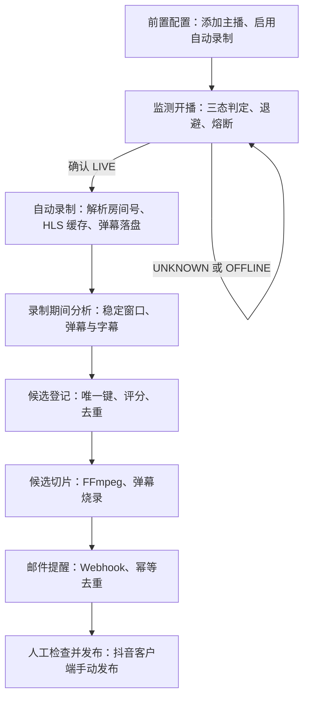

# 抖音自动化功能描述

| 项目 | 值 |
| --- | --- |
| 文档编号 | `FDES-001` |
| 编制日期 | `2026-10-14` |
| 版本 | `0.3` |
| 状态 | 待评审（与 `DY-AUTO-001` v0.6 同步） |
| 依据方案 | `DY-AUTO-001`《抖音直播自动录制与高光切片方案》v0.6 |

## 1. 文档说明

本文描述抖音自动化从监测开播到人工发布的完整功能流程，说明系统各阶段"做什么、怎么运转、边界在哪"，供方案评审和开发理解使用。

功能规则以方案条目为准（`REQ-*`、`FLOW-*`、`SCORE-*`、`DATA-*`），待评审参数以 `RVW-*` 为准；数据库字段、接口签名和前端控件等实现细节留给 `DDES-001` 详设。建议阅读顺序：方案（目标与决策）→ 本文（完整流程）→ 详设（实现方案）。

## 2. 流程总览

分析在直播期间持续进行；候选切片与邮件提醒的生成时机由 `RVW-007` 决定，第一阶段建议在直播结束后统一生成。监测支持两种添加方式：房间号/直播间链接（直接监测房间），或主播主页/分享链接（以 sec_uid 监测，首次开播时自动解析房间号）。

## 3. 前置配置（`FLOW-001`）

- **功能**：用户添加抖音主播并启用自动录制，作为整条自动化链路的入口。
- **输入**：抖音账号（Cookie）与主播标识（房间号/直播间链接，或主播主页链接、分享短链、手动 sec_uid）；可选配置：轮询间隔、输出与缓存目录、字幕后端、LLM、Webhook URL、`auto_generate`。
- **处理**：注册录制器并进入监测循环；主页方式解析归一为 sec_uid；应用重启后按启用状态自动恢复监测。
- **输出**：主播出现在房间列表，监测循环开始运行。
- **入口**：添加在现有"添加直播间"对话框完成，不新建管理页面；房间列表展示房间号解析状态（`MOD-005`）。
- **关联**：`REQ-001`、`REQ-013`；相关参数在 `GATE-001` 评审确认。

## 4. 监测开播（`MOD-001`）

**功能目标**：以尽量少的请求及时发现开播，接口异常时不误判状态。

- **监测模式**：房间号模式直接轮询房间状态（现有链路）；主播标识模式（sec_uid）走用户级通道：签名用户接口为主、`webcast/room/info_by_user` 交叉确认；双源确认离线后降频，每 10 轮或每 5 分钟全量巡检；首次确认开播时解析房间号并转入房间级监测（`REQ-014`）。
- **轮询**：后台循环按默认 30 秒执行，带随机抖动；间隔可配置更长（`REQ-004`）。
- **房间级查询链路**：Webcast 主接口；仅当响应为空、解析失败或请求失败时回退 H5 接口，常规轮询不发起双源请求（`REQ-003`）。
- **三态判定**（`REQ-002`）：`LIVE`、`OFFLINE`、`UNKNOWN`。网络错误、无法解析的响应和多来源冲突均归 `UNKNOWN`；`UNKNOWN` 不改变确认状态，不触发开播或下播事件。
- **状态转换**（同方案 §6.1）：
  - 未确认或未开播收到 `LIVE`：建立直播场次，发出一次开播事件并启动录制；
  - 开播中收到 `LIVE`：只更新直播间元数据；
  - 开播中收到 `OFFLINE`：确认场次结束，结束录制并进入收尾；
  - 任何状态收到 `UNKNOWN`：保持现状，不结束录制。
- **失败与限流**（`REQ-005`）：启动阶段失败先按 10、30、60 秒重试，之后渐进退避（逐次加倍，上限 5 分钟，带抖动）；存在 `Retry-After` 时优先遵循；任何明确成功结果立即重置退避；连续异常达到阈值（`RVW-005`，建议 10 次）暂停该主播检测并只通知一次。
- **会话与风控**（`REQ-015`）：监测请求使用 ttwid 会话（先从 `live.douyin.com` 初始化）；空响应时重建会话并设置冷却，避免风暴重试；验证页、验证码或限流信号按 `UNKNOWN` 处理，不改变确认状态。
- **隔离**：单主播错误不阻塞其他平台任务；检测状态与录制流状态分别维护。
- **可观测**（`REQ-007`）：可查询最近检测时间、确认状态、错误类别（账号失效、限流、网络错误可区分）和下一次重试时间。
- **边界**：退避期间用户主动查看主播是否强制探测一次，见 `RVW-006`。

## 5. 自动录制（`FLOW-002`，复用现有）

- **触发**：监测确认 `LIVE`（sec_uid 模式下先解析房间号，再进入录制）。
- **事件序列**：
  1. `LiveStart`：发送 `live.started` Webhook 和桌面通知。此时平台场次标识可能为空（抖音在取流阶段才写入），该事件不代表录制已经开始。
  2. 取流并启动录制：解析直播流地址，开始写 HLS 缓存。
  3. `RecordStart`：写入 records 记录行，`parent_id` 即平台场次标识，此后场次键可用；发送 `record.started`。
  4. 录制中：每个新 segment 触发 `RecordUpdate`，持续更新时长与大小。
  5. `RecordEnd`：发送 `record.ended`；时长或大小为空的录制自动清理。
- **产物**：`cache/{平台}/{房间}/{live_id}/` 下的 `playlist.m3u8`、segment 文件和 `events.jsonl` 弹幕文件；records 记录行。
- **边界**：分析任务挂 RecordStart 及记录行，不挂 LiveStart（`DATA-003`）。

## 6. 录制期间分析高光（`MOD-002`，新增）

- **触发**：录制开始后，分析调度按周期推进（现有任务系统只支持按需任务，调度器为新增件）。
- **稳定窗口**（`FLOW-003`）：只消费 playlist 中已完成 segment 的前缀，排除正在写入的末段；时间轴以 `first_segment_timestamp` 对齐直播起点。
- **信号采集**：
  - 弹幕：`events.jsonl` 按窗口聚合，复用现有密度分析并叠加相对直播基线的突增（`SCORE-001`）；
  - 增量字幕（`REQ-009`）：按窗口提取音频、调用字幕后端、按偏移拼接结果；窗口粒度与后端见 `RVW-008`（建议 5–10 分钟，本地 Whisper 复用长驻实例）；
  - 画面抽帧（`SCORE-003`）：可选，模型支持图像输入时启用。
- **评分**（`SCORE-001` 至 `SCORE-004`）：弹幕热度、语音内容、画面信息、片段质量，用于候选排序和过滤；LLM 未配置时降级为弹幕与片段质量评分。
- **候选登记**（`FLOW-004`、`DATA-001`）：合并相邻候选区间、补足前后文，按唯一键（主播 + 场次 + 时间范围）去重；记录评分信号、推荐理由和失败原因。
- **持久化与恢复**（`REQ-008`）：进度、候选与失败状态沿用 `record_summaries` 的 status/stage 模式，重启后可续跑，不重复生成候选。
- **约束**：分析异常不阻断录制；分析频率、抽帧数量和单场切片数受上限控制（`RISK-005`）。

## 7. 候选切片生成（`MOD-003`）

- **触发**：候选登记完成后进入切片任务；生成时机见 `RVW-007`（第一阶段建议直播结束后统一生成，避开末段不完整与资源争抢）。
- **处理**：复用现有 FFmpeg 切片能力，直接读取缓存 playlist；可烧录弹幕、可选生成字幕；与自动整场切片共用任务和产物记录链路。
- **幂等**（`DATA-002`）：同一候选唯一键不重复生成；失败按任务状态重试。
- **产物**：video 记录行、封面文件、可选字幕；完成后发送 `clip.generated`。

## 8. 邮件提醒（`MOD-004`）

- **触发**：`clip.generated` 事件。
- **处理**：Webhook 投递（传输层已有 3 次重试），外部邮件服务按 payload 中的候选唯一键去重后发送。
- **邮件内容**：主播、直播场次、时间范围、评分、推荐理由和可访问链接。
- **链接**：指向现有 `/output`、`/cache` 静态路由；这两个路径无认证，远程部署需使用 VPN 或带认证的反向代理（`RISK-006`）。
- **失败处理**：发送失败重试通知，不重复生成切片；提供参考接收器供 `PH-003` 验收。

## 9. 人工检查与发布（`FLOW-007`）

- **前端展示**（`MOD-005`）：主播检测状态（含未知、退避、最近错误）、房间号解析状态、自动化任务状态、候选评分与切片链接；候选状态枚举沿用 status/stage 模式。
- **发布**：用户查看候选后在抖音客户端手动发布；系统不调用抖音投稿接口（`REQ-012`）。

## 10. 数据、状态与存储

- **主播标识与房间号**：sec_uid 为主播唯一键；web_rid 在首次开播时解析并持久化，解析状态可查询（`REQ-013`、`REQ-014`、`DATA-005`）。
- **场次键**：`records.parent_id`，RecordStart 起可用（`DATA-003`）。
- **候选唯一键**：主播 + 直播场次 + 时间范围（`DATA-002`）。
- **状态域**：检测状态（三态、退避、熔断信息）、录制状态、分析进度、候选状态、通知状态。
- **存储**：复用 records、videos、tasks、record_summaries；候选记录按详设新增。缓存目录存放录制中数据，输出目录存放切片产物。
- **敏感信息**：Cookie 不写入日志或邮件（`DATA-004`）。

## 11. 异常与降级

| 场景 | 行为 |
| --- | --- |
| 查询失败或限流 | 归 `UNKNOWN`，退避重试；不误发下播事件。 |
| 会话异常（空响应、验证页） | 重建会话并冷却，按 `UNKNOWN` 处理，不改变确认状态（`REQ-015`）。 |
| 账号失效 | 错误类别可区分，显示并可恢复；不中断其他主播。 |
| 连续异常达阈值 | 暂停该主播检测并只通知一次（`RVW-005`）。 |
| 用户级接口失效 | 多源兜底与健康检测；房间号已知时退回房间级通道（`RISK-008`）。 |
| 字幕模型不可用 | 降级为弹幕与片段质量评分，不影响录制。 |
| LLM 未配置 | 跳过语音内容评分，其余评分照常。 |
| 磁盘空间不足 | 切片任务按现有检查拒绝执行并提示。 |
| 应用重启 | 清理未完成任务状态，分析续跑，场次与候选任务不重复创建。 |

## 12. 部署形态

桌面版与 Docker headless/Web 部署共用同一后端任务流程（`REQ-012`、`MOD-006`）；媒体文件通过 `/output`、`/cache` 路由提供，邮件链接直接引用。

## 13. 待评审参数

| 编号 | 事项 | 建议 |
| --- | --- | --- |
| `RVW-001` | 抖音轮询 30 秒硬下限 | 建议确认 |
| `RVW-002` | 退避上限 5 分钟 | 详设初始值 |
| `RVW-003` | 启动时已开播是否通知 | 建议开录并按场次去重 |
| `RVW-004` | 外部代码是否复制 | 当前不复制 |
| `RVW-005` | 连续异常熔断阈值 | 建议 10 次 |
| `RVW-006` | 退避期手动探测 | 建议允许但限频 |
| `RVW-007` | 候选切片生成时机 | 建议直播结束后统一生成 |
| `RVW-008` | 增量字幕后端与粒度 | 建议 5–10 分钟窗口 |
| `RVW-009` | 用户级监测全量巡检参数 | 建议照用经验值，上线后按限流调整 |

## 14. 追踪关系

| 本文阶段 | 方案条目 | 验收 |
| --- | --- | --- |
| 前置配置 | `FLOW-001`、`REQ-001`、`REQ-013` | `AC-001`、`AC-009` |
| 监测开播 | `REQ-002`–`REQ-007`、`REQ-014`、`REQ-015` | `AC-001`–`AC-004`、`AC-009`、`AC-010` |
| 自动录制 | `FLOW-002`、`REQ-006` | `AC-001`、`AC-004` |
| 录制期间分析 | `REQ-008`、`REQ-009` | `AC-005` |
| 候选切片 | `REQ-010` | `AC-006` |
| 邮件提醒 | `REQ-011` | `AC-007` |
| 人工检查与发布 | `FLOW-007`、`REQ-012` | `AC-008` |

## 15. 修订记录

| 版本 | 日期 | 说明 |
| --- | --- | --- |
| `0.1` | `2026-10-14` | 依据 `DY-AUTO-001` v0.4 建立功能描述。 |
| `0.2` | `2026-10-14` | 同步方案 v0.5：新增按主播标识添加与用户级监测流程（`REQ-013`–`REQ-015`）、会话与风控、房间号解析交接；更新异常降级表、追踪关系与待评审参数。 |
| `0.3` | `2026-10-14` | 同步方案 v0.6：明确添加入口在现有"添加直播间"对话框扩展、不新建管理页面；前端展示补充房间号解析状态。 |
