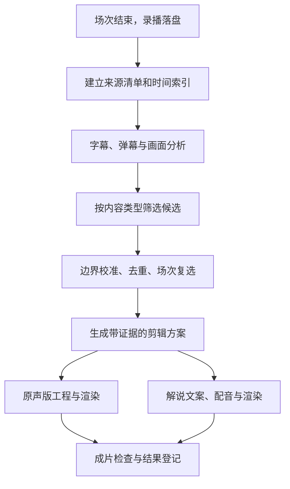

# 自动化切片与 AI 成片设计

## 1. 文档定位与目标

本文定义跨平台自动化切片子系统的内容分类、高光筛选、剪辑编排、模型接入、
成片生成和任务恢复规则，是这些设计的统一来源。
文中的新增模块、字段和流程属于实施方案；参数建议需要通过录播样本验证。

目标流程：录播可用后，自动选出具有内容价值的片段，生成可编辑工程和视频文件，
支持保留原声的增强版、增加 AI 解说的版本，以及同时生成两个版本。

设计范围包括项目已支持平台产生的录播。平台开播监测、账号和录制器继续由对应模块负责，
抖音监测设计见[抖音自动化详设][douyin-design]。
素材、切片工程和投稿的数据语义见[素材、切片与投稿][material-project]。
自动投稿、平台监测重构、外部素材搜索和生成式视频补画面不属于本方案交付范围。

核心约束：

- 录制任务与分析、渲染任务分离，模型故障不得阻断录制。
- 模型提供结构化判断和剪辑方案，后端负责校验和执行。
- 所有选片范围、事实描述和原声引用必须能回溯到来源录播。
- 同一候选的分析结果和源素材供两种输出复用，各版本独立生成和重试。
- 桌面端与 Docker 网页端共享后端流程，自动任务不依赖编辑器窗口。
- 看点以内容价值和完整性衡量，播放表现需要通过实际作品反馈评估。

## 2. 实现基础与接入边界

| 已有基础 | 代码归属 | 本方案需要补齐的部分 |
| --- | --- | --- |
| 场次结束事件与整场生成 | `src-tauri/src/recorder_manager.rs` | 高光工作流调度，与整场导出分别配置 |
| 素材截取、工程创建 | `src-tauri/src/handlers/project.rs` | 从剪辑方案创建工程与来源映射 |
| 录播转写、LLM 精彩片段总结 | `src-tauri/src/handlers/summary.rs` | 分窗分析、证据引用、分类与复选 |
| 模型请求与图像消息处理 | `src-tauri/src/agent/mod.rs` | 工作流使用的模型能力适配与结构校验 |
| 素材抽帧 | `src-tauri/src/handlers/video_editing.rs` | 面向录播播放列表和时间范围的抽帧入口 |
| 工程主视频轨、字幕和弹幕 | `src-tauri/src/project.rs` | 解说音轨、画面提示与版本兼容 |
| FFmpeg 工程渲染 | `src-tauri/src/ffmpeg/project.rs` | 解说混音、画面强调及无界面字幕编译 |
| 分析表、候选表的迁移定义 | `src-tauri/src/main.rs` | 存储操作、结果表、恢复与幂等 |
| 任务队列、进度和取消 | `src-tauri/src/task/mod.rs` | 分析限流、父子任务协调和阶段检查点 |

分析表与候选表有迁移定义，不代表自动选片工作流已接通。
现有整场自动生成由 `auto_generate` 控制；本方案通过独立的自动化切片配置启用。
两种生成任务均直接消费录播缓存，高光生成不等待整场 MP4 导出完成。

聊天助手的工具确认流程服务于交互式操作。
自动化任务使用固定的后端服务调用链，模型响应中不得包含可执行命令或任意文件路径。

## 3. 内容类型与输出模式

### 3.1 内容类型枚举

内容类型与输出模式分别建模，避免把业务类型、分类方式和成片形式混合。

```rust
/// 直播内容类型，决定候选筛选和剪辑策略。
#[derive(Debug, Clone, Copy, serde::Serialize, serde::Deserialize)]
#[serde(rename_all = "snake_case")]
pub enum LiveContentType {
    Chat,
    Knowledge,
    Gaming,
    Sports,
    Commerce,
    Mixed,
    #[serde(other)]
    Other,
}

/// 候选切片需要生成的成片版本。
#[derive(Debug, Clone, Copy, serde::Serialize, serde::Deserialize)]
#[serde(rename_all = "snake_case")]
pub enum ClipOutputMode {
    Original,
    Commentary,
    Both,
}
```

`Both` 是生成请求，执行时展开为 `Original`、`Commentary` 两条独立结果。
`Other` 用于无法可靠分类或遇到未知类型值的情况。
无法识别的输出模式应返回配置错误，避免静默选择成片形式。

### 3.2 分类规则

- 房间配置保存默认类型和是否允许自动分类，任务启动时保存配置快照。
- 关闭自动分类时采用房间类型；`Mixed` 要求开启按片段分类。
- 开启自动分类时，房间类型作为提示，模型按候选片段返回具体类型、依据和置信度。
- 用户显式指定的片段类型优先于自动判断，重新分析不得覆盖该指定值。
- 分类置信度不足时使用通用策略，并保留原因；不强行套用某一内容类型。
- `Mixed` 表示一场录播包含多类内容，候选应归为具体类型或 `Other`。

首版以枚举映射策略配置，转写、裁剪、字幕、渲染和恢复流程保持共用。

### 3.3 类型策略

| 类型 | 优先识别的看点 | 片段完整性要求 | 成片增强重点 |
| --- | --- | --- | --- |
| `Chat` | 问答、反转、有趣互动、情绪变化 | 保留问题、关键回应与结果 | 原声反应、对话重点、真实弹幕 |
| `Knowledge` | 清晰观点、方法、论证、有效信息 | 保留结论与支撑依据 | 重点提示、术语解释、结构化字幕 |
| `Gaming` | 精彩操作、失误、逆转、关键事件 | 覆盖事件前因、操作过程与结果 | 关键画面强调、必要背景、原声反馈 |
| `Sports` | 关键事件、比分变化、局势反转 | 保留事件连续性与结果 | 过程展示、结果说明、适度回看 |
| `Commerce` | 产品演示、效果对比、问题解决 | 讲解与演示证据对应 | 对比提示、产品重点、真实效果 |
| `Other` | 可独立理解的完整事件或话题 | 依据充分、语义完整 | 通用标题、字幕与必要说明 |

类型策略配置评分项、权重、候选长度偏好、上下文保留方式和解说模板。
长度偏好用于排序与编排，不能直接截断一句话或事件结果。
缺少某种输入时记录可用信号并重新计算权重；缺少弹幕本身不构成淘汰理由。

## 4. 工作流与触发



### 4.1 下播处理

首版在 `LiveEnd` 后执行整场分析，也允许对指定已完成录播手动启动相同工作流。
`RecordEnd` 用于确认录制段已封口、记录最终范围；不直接代表整场结束。
调度器核对来源清单中的录制段已封口后开始分析，包含不足一个窗口的尾部内容。
事件顺序异常时等待段落收尾并记录原因，超时进入可恢复状态。

事件处理只登记任务并唤醒调度，不等待模型调用或视频渲染。
同一场次的重复事件通过输入指纹和任务认领去重。
应用启动恢复只处理持久化的未完成任务，不扫描并重做所有历史录播。

### 4.2 来源清单与时间基准

来源清单按平台、房间、场次和录制段登记，保存排序依据、可用时长及媒体指纹。
录制段明确按开始时间排序，开始时间相同时使用稳定的段标识排序。
源文件缺失或无法读取时记录失败段，不能把缺失内容默默视为成功处理。

- 所有持久化区间使用整数毫秒和半开区间 `[start_ms, end_ms)`。
- 来源区间必须同时包含平台、房间、`parent_id` 与 `live_id`。
- 录制段内时间、素材时间和工程时间分别保存映射，不混用直播时钟与播放进度。
- 弹幕按媒体时间锚点归一，复用录播时间戳处理能力，禁止用首条弹幕代替录播起点。
- 媒体时间锚点不足时降低对齐置信度，并停止使用无法可靠对齐的信号。
- 重叠分析窗口共享来源坐标，同一语句和事件具有稳定的证据标识。
- 首版候选限制在单个录制段内；场次级去重与排序可以跨段执行。

转写和预览可使用提取后的音频、低清代理和缩略图，正式生成回到原始来源。
分析和渲染期间保留来源引用，清理操作需避开仍被任务使用的文件。

## 5. 高光识别与筛选

### 5.1 分层采集

字幕识别先建立带时间的语句索引；已有可用转写按媒体指纹复用。
长录播采用分窗和重叠上下文，尾部单独收尾，避免话题在窗口边界被遗漏。
采集过程保留字幕、弹幕、帧或短视频片段与来源区间的对应关系。

聊天、知识类优先用字幕和弹幕粗筛，再对候选画面复核。
游戏、赛事类增加低采样率画面巡检，候选事件附近提高采样率或提交短视频。
少量静态帧不足以判断操作过程时，补充连续画面，而不是直接给出确定结论。

### 5.2 候选产生

候选来源包括语义话题、互动与情绪变化、弹幕突增、画面事件。
已有前端弹幕峰值算法可以作为输入之一，其密度统计应抽为可被后端复用的计算能力。
不同信号共同提出候选，不要求每个候选都同时拥有字幕、弹幕和画面证据。

模型输出受结构约束，至少包含：

- 内容类型与分类置信度。
- 候选的字幕、镜头或事件证据标识。
- 看点说明，以及前因、关键过程、结果对应的证据。
- 内容价值、完整性、独立理解难度和冗余程度的判断。
- 需要补充查看的上下文与缺失证据。

模型不得凭空填写来源位置。后端根据证据标识定位范围，校验媒体边界；
返回未知证据或缺少必要依据的候选应被拒绝或补充分析。

### 5.3 精筛与场次复选

先检查来源存在、范围合法、依据充分和关键结果完整，再按类型策略评分。
候选需要回答“观众能看到什么”和“为什么这一段值得单独观看”。
高热度不能替代内容价值，低热度不能单独否决精彩操作或有效知识。

精筛步骤：

1. 使用句子、停顿和画面事件校准起止点，保留必要的上下文。
2. 相邻候选描述同一事件时合并，再验证完整性和目标时长。
3. 对来源重叠和语义重复分别去重，避免同一高光被不同窗口重复提交。
4. 在场次内复选，兼顾质量、话题差异和配置的数量上限。
5. 对完整性不足的长候选重新编排或放弃，避免按秒数机械截断。

没有合格候选时返回已完成且候选为空，并说明原因，不强制凑足数量。
评分权重、门槛和长度偏好属于版本化策略，调整后保存新配置快照。

## 6. 两种成片的编排

### 6.1 原声增强版

保留关键对话、动作与反应，删除不影响理解的等待和重复。
开场可使用来源中的关键瞬间或准确的提示文字，再交代必要前因并展示结果。
开场重复使用某个瞬间时，方案需标记为有意回看，供去重和质量检查区分。

增强元素限定为与内容对应的标题、重点字幕、关键词强调、画面局部放大和真实弹幕。
标题不能超出来源事实，弹幕不能伪造成观众反应。
产品参数、比分与知识结论须有对应证据；依据不足时省略该提示。
画面放大范围和字幕位置需避开关键操作区域、比分或产品演示区域。

### 6.2 AI 解说版

解说结构为：简短引入、必要背景、关键过程、保留原声的高潮、结果解释或点评。
知识类可按“问题、方法、依据、结论”组织，其他类型由策略决定叙事顺序。
背景信息来源于本次录播证据；需要外部背景但没有可用依据时，省略相关断言。

每条解说保存对应证据和插入位置，区分事实转述、解释与主观点评。
主播原话字幕与新增解说字幕分别生成，避免把解说文字呈现为主播发言。
关键原声保留独立播放空间，其他解说段按音量策略适度压低现场声。

配音生成后测量真实时长，再校验镜头长度和播放位置。
解说超出镜头时，依次尝试精简文案、使用已验证的上下文画面、调整剪辑方案；
无法适配时标记该版本失败，避免无限改写或任意延长素材。
定格和回看只使用来源画面，并在方案中显式标记。

### 6.3 共享与独立性

两种版本共享候选证据和源素材，分别保存工程、剪辑方案和渲染结果。
解说版失败不影响已完成的原声版，重试只执行失败版本所需阶段。
各版本均保留可编辑工程，自动重试不得覆盖用户编辑后的工程或已有成片。

## 7. 模型接入与输出约束

### 7.1 模型分工

| 能力 | 输入与输出 | 接入方式 |
| --- | --- | --- |
| 语音识别 | 音频转带时间字幕 | 复用已有字幕生成器 |
| 语义分析与文案 | 字幕、证据转分类、候选和解说 | 复用 LLM 配置与请求基础 |
| 画面理解 | 带时间的帧或短视频转事件证据 | 增加图像、视频能力适配 |
| 语音合成 | 解说文本转音频与实测时长 | 增加独立 TTS 适配 |

适配层声明支持的文本、图像、视频、结构化输出和语音能力。
接口兼容性按具体服务验证，文本请求可用不代表原生视频或语音接口可用。
模型名称、端点和语音风格配置化，选择依据是目标样本效果、部署资源与预算。

画面理解可评估 [Gemini 视频理解][gemini-video]、[Qwen3-VL][qwen-vl]；
语音合成可评估 [Qwen3-TTS][qwen-tts] 或兼容的托管服务。
这些是能力参考，不构成固定运行依赖或效果承诺。

### 7.2 请求与响应

- 自动化使用独立任务上下文，提供内容类型、目标成片方式和允许引用的证据。
- 明确要求结构化输出，对缺字段、非法类型和不存在的证据进行程序校验。
- 服务支持结构化输出时使用其能力；语法修复次数受限，事实错误不得靠补写修复。
- 字幕、弹幕和画面文字只作为待分析内容，不作为工作流指令。
- 模型不能改变输出目录、预算、任务状态或调用任意工具。
- 保存模型标识、提示模板版本和有效参数，凭证不进入方案、日志或前端结果。

### 7.3 成本与降级

音频、转写、抽帧、模型分析和 TTS 分阶段缓存。
缓存键包括媒体指纹、模型与模板版本、有效配置；修改标题不触发重新转写。
候选优先使用低成本信号粗筛，连续画面精看只覆盖必要范围。
每场配置请求预算、输入长度上限和并发限制，预算耗尽保留检查点与未完成原因。

缺少弹幕时使用内容和画面；无有效语音时使用适用的画面策略。
缺少任务必需的模型能力时等待配置或明确失败。
解说失败是否保留原声输出由请求的版本决定，不能把未生成的解说记为成功。

## 8. 剪辑方案与时间轴

### 8.1 方案契约

剪辑方案以版本化结构保存，包含来源引用、排列顺序、原声保留区间、解说、
画面提示、字幕样式引用和输出规格。
每个操作都有稳定标识和证据引用，时间使用来源时间或工程时间并明确标注。
后端限制操作类型、文本长度和资源引用，生成 FFmpeg 参数时使用受控编译逻辑。

采用“来源区间到素材区间，再到工程区间”的映射。
原声素材采用流复制时可能受关键帧影响，编译器需读取实际素材范围和时长校准，
不能把请求范围直接作为精确素材起点。
叙事需要精确边界时，在最终渲染阶段准确裁剪或按需重新编码。

### 8.2 工程扩展

在工程时间轴版本中增加解说轨和画面提示轨，主视频轨继续使用素材引用。
解说项记录音频引用、工程起点、实测时长、音量和对应文本；
画面提示记录类型、位置、时间范围、内容或来源画面引用。
裁剪、重排或回看片段后统一重新映射字幕、弹幕、提示和音轨。

同一段语音同时需要字幕和配音时共用文案标识，字幕时间在配音生成后对齐。
配音服务没有可靠字级时间时使用句级字幕，避免伪造逐字同步。
输入文件和输出参数均需校验，来源素材在渲染期间保持只读。

工程版本升级需补充默认字段及可读性检查。
编辑器不能完整展示某版本时必须提示能力限制，不能保存时丢弃未知轨道。
原声与解说版使用独立工程，分别绑定对应方案版本。

### 8.3 无界面渲染

自动任务在后端完成 ASS 字幕与样式编译，并与编辑器预览保持同一份样式约定。
桌面、Docker、预览和导出使用相同时间映射与字体资源。
横竖屏及画布规格显式保存，未配置的画面格式沿用工程支持的规格。
智能竖屏裁切需独立验证主体和关键区域，不自动假定画面中心为有效内容。

成片先写入临时文件，验证后再登记并替换目标。
检查失败保留明确状态和必要诊断，避免覆盖已有有效文件。

## 9. 持久化、幂等与恢复

### 9.1 数据归属

复用分析表和候选表，通过后续迁移补充字段及结果表，迁移同时覆盖 GUI 与 headless。
数据库保存结构化状态与权威剪辑方案；媒体文件保存在任务或工程所属目录。
不在多个文档或文件中维护同一份可变方案副本。

| 数据归属 | 需要承载的设计信息 |
| --- | --- |
| 分析记录 | 输入指纹、配置快照、策略与模型版本、阶段和检查点 |
| 候选记录 | 类型、置信度、证据、评分项、来源范围和筛选原因 |
| 成片结果记录 | 候选、具体输出模式、方案版本、工程、状态和检查结果 |
| 素材与工程 | 可编辑视频、字幕、来源映射及新增轨道 |

剪辑方案以结果记录中的结构化数据为权威，工程时间轴是其可编辑执行结果。
用户编辑后的工程标记为已修改，任务重试创建新结果或继续原任务未完成阶段，
不得根据缓存指纹覆盖人工修改。

### 9.2 唯一性与任务认领

场次分析键包含平台、房间、场次、输入指纹和策略版本。
候选去重键至少包含 `live_id`、范围和策略版本，来源重叠与语义重复另行判断。
候选表的唯一约束需要纳入录制段标识，避免同场不同段的相对时间碰撞。

结果执行键包含候选、具体输出模式和方案指纹。
同一版本重试复用结果记录，明确重新分析才创建新的分析版本。
任务执行前通过数据库条件更新认领，并保存租约或执行标识，避免并发重复生成。
任务执行期间有效配置保持固定，配置更新只作用于新任务或显式重跑。

### 9.3 状态与恢复

分析阶段包括待执行、索引、转写、分析、复选和完成；
成片阶段包括待执行、编排、配音、渲染、检查和完成。
失败、等待重试、中断和取消分别记录，不以阶段文字代替执行状态。
父任务按子结果汇总：全部完成、部分完成、失败或取消。

- 网络失败按服务响应执行有限重试，凭证和参数错误直接等待修正。
- 重启后将没有有效执行者的运行任务标记为中断，从已验证检查点恢复。
- 取消需要终止对应请求或子进程，保留共享缓存与已完成版本。
- 结果文件存在但没有完成登记时，先验证文件及方案指纹，再决定登记或重做。
- 活跃任务占用的来源与共享产物不能被另一版本取消或清理。
- 删除任务产物时按引用关系清理，使用者仍存在的素材和工程不能级联删除。

### 9.4 队列约束

复用任务、进度和取消体系，分析请求与本地推理按资源独立限流。
父流程作为轻量协调任务，不占用渲染执行槽等待其子任务完成。
需要验证单执行槽配置，避免父任务等待排在自己后面的子任务而形成死锁。
取消和预算耗尽应在窗口、模型请求、配音段和渲染阶段之间设检查点。

## 10. 配置与操作入口

全局配置提供默认策略，房间配置提供类型和输出偏好。
任务建立时固化有效配置，设置页展示对应能力是否就绪及缺失原因。

| 配置项 | 建议初值或规则 |
| --- | --- |
| 自动化切片开关 | 默认关闭，由用户启用 |
| 内容类型 | `Mixed`，按候选分类；支持房间指定 |
| 输出模式 | 支持三种模式，用户需求为 `Both` |
| 分析窗口与重叠 | 建议 300 秒、30 秒，尾部独立处理 |
| 候选时长偏好 | 按内容类型配置，完整性优先 |
| 单场候选数量 | 建议上限 5 条，允许没有合格候选 |
| 模型与配音 | 分别指定能力、版本、预算及并发 |
| 标题、重点提示和弹幕 | 按输出模板配置，内容须有来源 |

窗口和数量是离线评估的初值，不是已验证的质量结论。
评分门槛、分类置信度和各类型片长由评估集确定，未经评估不写成统一效果保证。

前端复用设置页、任务中心和工程编辑器，增加候选查看与结果入口。
用户可查看来源、推荐理由、所用策略及两种版本各自的状态，支持调整类型与重试失败版本。
人工操作和自动触发使用相同后端服务；HTTP 与 Tauri 只负责输入校验和传输适配。
结果通知复用现有事件体系，候选状态通知与成片完成通知区分。
是否扩展 Webhook 负载需验证已有消费者兼容性。

## 11. 模块职责

新增后端 `automation` 子系统负责调度、内容分类、信号聚合、候选评分和剪辑编排。
模型适配与任务存储在子系统内形成明确边界，避免把流程堆入录制事件处理器。

相关模块协作如下：

- 录制管理器提供场次、段落收尾与来源索引，唤醒自动化任务。
- 字幕与音频模块提供带来源映射的转写，供总结和自动化流程复用。
- 数据库模块保存分析、候选、结果与检查点，发布已提交的数据变更。
- 工程模块负责方案校验、素材映射、轨道编译及可编辑工程创建。
- FFmpeg 模块负责裁剪、字幕、配音混合、画面强调和输出验证。
- 前端负责配置、候选检查、任务展示与工程编辑，不承担自动化执行循环。

模型和 TTS 优先通过已有请求基础或服务适配接入。
是否增加本地推理依赖，在确定模型、硬件和部署方式后决定。

## 12. 实施顺序与交付

| 阶段 | 交付范围 | 完成条件 |
| --- | --- | --- |
| P1：自动原声成片 | 类型枚举、录播索引、模型选片、候选存储、原声工程与导出 | 下播或手动启动后可独立产出原声增强版 |
| P2：解说与双版本 | 解说方案、TTS、音轨、画面提示、双版本独立恢复 | 同一候选可生成两版，任一失败不破坏另一版 |
| P3：质量与部署验收 | 类型样本评估、故障恢复、资源限制、双端验证 | 满足验收矩阵并记录成本和耗时 |

每阶段均交付配置、可观测进度、取消与恢复能力。
优先验证下播后处理，录制中增量分析作为后续扩展，沿用相同来源坐标和候选契约。

## 13. 验证与验收

### 13.1 自动化检查

模型响应采用固定样本和模拟服务验证，测试无需访问直播平台或付费模型。
媒体检查使用短视频、音频和分段播放列表夹具，长录播评估独立运行。

| 验收项 | 判定依据 |
| --- | --- |
| 类型与模式 | 枚举序列化、未知类型回退、模式校验、混合内容分流 |
| 时间边界 | 毫秒换算、窗口重叠、尾部、关键帧偏移和录制段映射正确 |
| 来源依据 | 候选和解说引用有效，错误证据与越界区间被拒绝 |
| 去重 | 重复事件、窗口和并发请求不重复生成同一结果 |
| 成片映射 | 重排、回看和裁剪后字幕、弹幕、提示及音轨同步 |
| 双版本 | 原声成功而解说失败时准确展示部分完成，单独重试有效 |
| 无界面执行 | 关闭编辑器仍可生成字幕、配音和完整成片 |
| 故障恢复 | 超时、预算耗尽、重启、取消和空间不足有明确状态 |
| 文件完整性 | 临时文件不冒充成片，失败不破坏已有有效输出 |
| 资源与队列 | 单执行槽无死锁，分析故障和取消不影响录制 |
| 兼容性 | GUI、headless、HTTP 与 Tauri 的有效输入和行为一致 |

### 13.2 内容效果评估

使用覆盖聊天、知识、游戏、赛事、带货的录播样本，另加入混合类型、低弹幕、
无有效语音和跨窗口话题样本。标注精彩事件、必要上下文和不可删除的原声。

对比人工选片、弹幕峰值推荐和新方案，分别记录：

- 高光事件覆盖情况与候选人工采用率。
- 独立理解程度、语句与事件完整性、解说事实准确性。
- 重复片段比例、标题与画面匹配情况、音画及字幕同步情况。
- 每小时录播的分析耗时、模型消耗、缓存命中与单条渲染耗时。

质量门槛按内容类型确定；来源越界、错误事实和损坏文件作为必须修复的问题。
模型评分不直接充当人工采用率或作品传播效果。
模型、模板或策略升级后，在同一评估集复测并保留版本信息。

## 14. 相关设计与能力参考

- [素材、切片与投稿][material-project]：素材、工程、字幕与投稿的基础语义。
- [抖音自动化详设][douyin-design]：抖音监测与录制生命周期的配套设计。
- [Gemini 视频理解][gemini-video]：音视频事件分析与时间位置能力。
- [Qwen3-VL][qwen-vl]：图像与视频理解能力。
- [Qwen3-TTS][qwen-tts]：语音合成能力。

[material-project]: ../../development/architecture/material-project.md
[douyin-design]: ../../automation-plan/douyin-automation-detailed-design.md
[gemini-video]: https://ai.google.dev/gemini-api/docs/video-understanding
[qwen-vl]: https://github.com/QwenLM/Qwen3-VL
[qwen-tts]: https://github.com/QwenLM/Qwen3-TTS
